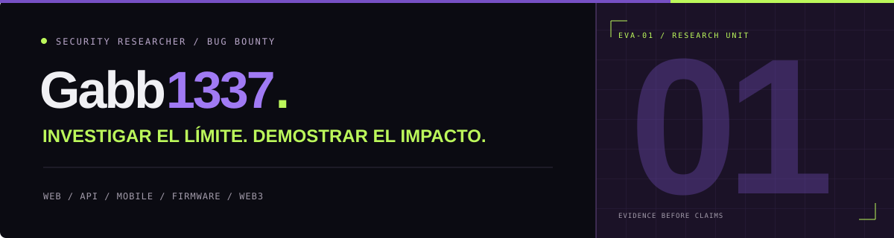

### Security Researcher · Bug Bounty Hunter

Web & API · Mobile · Firmware · Smart Contracts

**Investigar el límite. Demostrar el impacto.**

[Portafolio ↗](https://gabb1337sky-portfolio.fergabriel711.chatgpt.site) · [X](https://x.com/Gabbsec1337) · [LinkedIn](https://www.linkedin.com/in/gabb1337ro/)

---

Soy **Gabb1337**. Investigo controles de seguridad, construyo pruebas de concepto y documento el impacto que puedo demostrar. Mi trabajo combina revisión de código, pruebas diferenciales y análisis de aplicaciones, APIs, dispositivos y contratos inteligentes.

### Investigación

| Superficie | Líneas de trabajo documentadas |
| --- | --- |
| Web y APIs | IDOR/BOLA, autorización entre proyectos, XSS almacenado y lógica de negocio. |
| Autenticación y sesiones | Revocación, renovación de credenciales, dispositivos y canales persistentes. |
| Android | WebViews, puentes nativos, contexto de identidad y notificaciones. |
| Sistemas y cloud | SSRF, controles de salida, aislamiento y exposición de información. |
| Firmware | Análisis de binarios, rutas de datos, emulación y límites de validación física. |
| Web3 | Pruebas de invariantes, contabilidad y transiciones de estado; Move y revisión de Solidity. |

### Evidencia antes que afirmaciones

1. Definir el alcance, los actores y el control esperado.
2. Comparar baseline, control negativo y variante.
3. Demostrar el impacto con datos o entornos propios y registrar sus límites.
4. Deduplicar, redactar evidencia, proponer remediación y limpiar los artefactos.

Mi vault de Obsidian conecta hipótesis, notas de sesión, pruebas y decisiones con sus fuentes. Los expedientes de trabajo incluyen flujos de **Bugcrowd, HackerOne y HackenProof**.

### Divulgación responsable

El [portafolio](https://gabb1337sky-portfolio.fergabriel711.chatgpt.site) presenta nueve líneas seleccionadas con identidades anonimizadas. Los programas, objetivos, payloads, endpoints, credenciales y reportes originales permanecen reservados.

Los estados distinguen envíos, duplicados y validaciones locales: **un envío no equivale a aceptación ni recompensa**, y una prueba en emulación no se presenta como validación física.

Los repositorios de trabajo son privados. Este perfil público reúne únicamente la presentación del portafolio.

---

**Gabb1337 / RESEARCH UNIT 01**

[Explorar investigación](https://gabb1337sky-portfolio.fergabriel711.chatgpt.site) · [Conectar en LinkedIn](https://www.linkedin.com/in/gabb1337ro/)

Estética inspirada en EVA-01. Portafolio personal, sin afiliación oficial.

